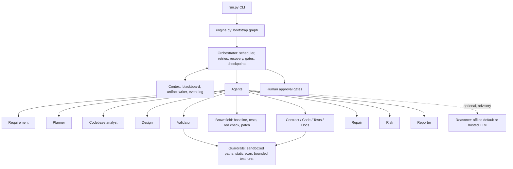
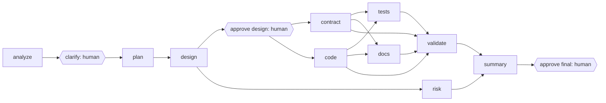

# Architecture overview

## What the system is

A workflow engine that turns a software requirement into a reviewable engineering outcome: requirements analysis, a task graph, a design, generated code, API contract and tests, validation, a risk register and a final summary. Agents do the work; humans approve at defined gates. It is not a chatbot.

## Components

| Component | Responsibility |
|---|---|
| **Orchestrator** | Runs a dependency graph; parallel execution of ready tasks; retry with backoff; recovery loop; approval gates; checkpoint and resume |
| **Context** | Shared blackboard, safe artifact writer (sandboxed), JSONL event log |
| **Requirement agent** | Intent, functional and non-functional requirements, ambiguities with proposed assumptions (blocking or assumable) |
| **Planner** | Builds the task graph and spawns it into the running orchestrator |
| **Codebase analyst** | AST scan of an existing repo: modules, imports, routes, SQL tables, call graph, data flows, code findings; impact analysis |
| **Design agent** | Architecture, data model, API list, capacity estimate, decisions and trade-offs (greenfield); change proposal and rollback (brownfield) |
| **Generators** | OpenAPI contract, source code, unit / integration / contract tests, documentation, or a patch plus regression tests |
| **Validator** | Static safety scan, contract and artifact checks, scope guard (brownfield), full test run |
| **Repair agent** | Maps failing tests to the module that caused them and regenerates it |
| **Risk agent** | Risk register, failure scenarios, validation strategy |
| **Reasoner** | Offline (deterministic rules) by default; optional hosted LLM, advisory only |

## Execution model and control flow

The graph is **dynamic**: the planner is a task that spawns the rest of the graph at run time. A task runs as soon as all its dependencies are `DONE`; independent tasks run in parallel.

Greenfield graph:

Brownfield graph: `scan -> impact -> design_change -> approve -> tests -> {red_check, patch} -> validate -> summary`, with `baseline` and `risk` running in parallel. Tests are written before the fix, must fail on the unpatched repo (red), and must pass on the patched copy (green).

### Cross-step coordination (not just a pipeline)

| Mechanism | What happens |
|---|---|
| Dynamic graph | The planner spawns the task graph after the requirement is approved |
| Parallelism | `contract` and `code` run together; `tests` and `docs` run together; `risk` runs beside approval |
| Contract-first coupling | The OpenAPI file is generated from the design; a contract test fails if routes, status codes or required fields drift from the code |
| Recovery loop | A failed `validate` spawns `repair_N` and `validate_N+1`, and every downstream task is **rewired** to wait for the new validation |
| Retry | Transient errors are retried with backoff (demonstrated with `--inject-fault`) |
| Escalation | A failure that no repair rule maps to a module is escalated: the task fails, dependants are skipped, the run ends `failed` |
| Checkpoint and resume | `state.json` is written after every task; `--resume` continues without re-running finished work |

## Controlled autonomy

Agents execute independently between gates. Humans approve:

1. **Interpretation and assumptions** (the system never silently guesses an ambiguity).
2. **The design** (no code is generated before this; a test proves it).
3. **The final outcome.**

Rejecting any gate halts all dependent tasks. The original repository is never modified; the brownfield outcome is a reviewable diff (`changes.patch`).

## Guardrails

- All writes go through a path sandbox (`safe_join`); path escapes raise an error.
- Generated Python is scanned for syntax errors, `eval` / `exec` / `os.system` / `subprocess` / `pickle`, string-built SQL, and hard-coded secrets.
- Tests run in a subprocess with a hard timeout.
- Brownfield scope guard: only modules named by the impact analysis may change.
- Repair is bounded (2 cycles).
- LLM output is advisory: schema-validated, tagged `source=llm`, can never create a blocking ambiguity, never overrides validation or gates.

## Key design decisions

| Decision | Reason | Trade-off |
|---|---|---|
| Deterministic validator and conclusions | Reproducible verdicts; an LLM must not grade its own work | Less flexible than model-based review |
| Offline engine with an LLM interface | Runs anywhere with no model or key; demonstrates the orchestration | Generation is template-driven until an LLM backend is plugged in |
| Blackboard context | Simple, inspectable, checkpointable | Not suited to very large artifacts |
| Thread pool for parallelism | Tasks are I/O or subprocess bound | Not for CPU-heavy agents |
| Standard-library output (WSGI, sqlite3, unittest) | Generated projects run and test with no installs | Production would use a framework and PostgreSQL |
| Test-first with a red check for brownfield | Proves the tests really reproduce the bug | Needs a runnable baseline |

## Extending it

- **Add a domain:** add templates under `agentic/templates/` and a branch in the planner.
- **Add a change type:** add a patch template, a test template, an intent rule in the requirement agent and a defect entry for repair.
- **Use a model:** set `LLM_API_KEY` (and optionally `LLM_BASE_URL`, `LLM_MODEL`). Today it enriches ambiguities and risks only. To generate code with a model, replace `render_greenfield_code()` / `render_patch()`; validation and repair stay unchanged.
