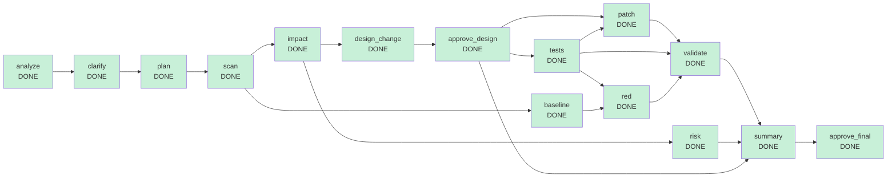

# Engineering summary

**Requirement:** Make the URL shortener faster and better for our users.
**Interpreted as:** brownfield change (url_shortener); ambiguity level high.

## 1. What was built and why

Improve redirect-lookup performance of the existing URL shortener by caching hot lookups in a bounded in-memory LRU with correct invalidation. (Interpretation of an under-specified request; needs confirmation.)

Impact analysis:

- Driver: Every redirect performs a database read; there is no caching layer.
- Modules modified: store; affected but unchanged: app
- APIs impacted: GET /<code>, POST /shorten

## 2. Assumptions the human approved

- B1 Meaning of 'faster': Redirect lookup. Success = repeated lookups of the same code are served without a database read.
- B2 Meaning of 'better': Out of scope until defined. Only the performance change is made.
- B3 Which users / traffic: Read-heavy redirect traffic with a skewed set of popular links.

Human approvals recorded: clarify (approved: auto-approved (demo mode): BLOCKING ambiguities were assumed, not answered), approve_design (approved: auto-approved (demo mode))

## 3. Implementation plan and rationale

| Task | Agent | Depends on | Why |
|---|---|---|---|
| scan | scan_repo | plan | Build a system-level model of the code before touching it. |
| impact | impact | scan | Decide what must change and what is only affected. |
| baseline | baseline | scan | Know the starting health so regressions are attributable. |
| design_change | design | impact | Change proposal grounded in the impact analysis. |
| approve_design | gate | design_change | A human approves the scope before any code changes. |
| risk | risk | impact | Runs in parallel with design and approval. |
| tests | bf_tests | approve_design | Tests are written before the fix (test-first). |
| red | red_check | tests, baseline | Proves the tests actually reproduce the problem. |
| patch | patch | approve_design, tests | Original repo is never modified; output is a patch. |
| validate | validate | patch, tests, red | Quality gate. On failure the orchestrator spawns repair and re-validation. |
| summary | summary | validate, risk, approve_design | Assemble plan, artifacts, risks, trade-offs and limitations. |
| approve_final | gate | summary | A human reviews the evidence before the outcome is accepted. |

## 4. Generated artifacts

**Project**

- `project/README.md` (147 bytes)
- `project/app.py` (1,782 bytes)
- `project/codegen.py` (141 bytes)
- `project/store.py` (1,393 bytes)
- `project/tests/__init__.py` (0 bytes)
- `project/tests/test_basic.py` (1,321 bytes)
- `project/tests/test_regression_cache.py` (2,122 bytes)

**Documentation**

- `docs/01_requirements.md` (1,425 bytes)
- `docs/02_plan.md` (1,949 bytes)
- `docs/03_design.md` (687 bytes)
- `docs/04_risks_and_validation.md` (1,996 bytes)
- `docs/impact_analysis.md` (332 bytes)
- `docs/repo_scan.md` (736 bytes)

**Regression tests (brownfield)**

- `new_tests/test_regression_cache.py` (2,122 bytes)

**Reviewable diff:** `changes.patch`

## 5. Validation results

- [PASS] static analysis: syntax, banned calls, SQL parameterisation, secrets: clean
- [PASS] scope guard: only files named by the impact analysis were modified: changed store.py
- [PASS] test suite (unit, integration, contract / regression): 8 tests in 2.37s
- [PASS] red check: 3 of 8 new tests failed on the unpatched repo, then passed after the change
- [PASS] baseline: the existing suite (3 tests) passed before any change

## 6. Risks, trade-offs and validation approach

| ID | Risk | Mitigation | Status |
|---|---|---|---|
| R1 | Stale cache serves an outdated URL | Entry invalidated on every save; covered by a test. | Mitigated, tested |
| R2 | Cache invalidation does not reach other processes | In-process cache only: use a TTL or shared cache before running multiple workers. | Known limitation |
| R3 | Unbounded memory growth | Fixed-size LRU with eviction; covered by a test. | Mitigated, tested |
| R4 | Negative lookups hammer the database | Unknown codes are deliberately not cached; a negative cache could be added. | Accepted |

Validation strategy:

- **Baseline:** Existing tests run on the untouched repo first, so regressions are attributable.
- **Test-first, red check:** New tests are written before the fix and must FAIL on the unpatched repo (proves they reproduce the issue).
- **Green check:** The full suite (existing plus new) must pass on the patched copy.
- **Scope guard:** Only modules named by the impact analysis may change.
- **Reviewable diff:** The change is delivered as changes.patch; the original repo is never modified.
- **Not covered:** Production traffic, multi-process behaviour and performance under load.

## 7. Assumptions and limitations

- Offline mode generates code from reviewed templates. Requirement analysis, planning, impact analysis, validation and repair are real logic, but open-ended code generation needs a hosted LLM behind the same agent interface.
- Repair is rule-based: it fixes failures that map to a known module and escalates everything else to a human.
- Offline mode covers the URL shortener domain (greenfield) and two change types on the sample repo (collision fix, LRU cache). Other requirements stop with a clear message.
- The optional LLM adapter is advisory only and has been exercised against a local mock endpoint, not a production provider.
- Validation runs the generated tests in a subprocess; it does not include load, soak, chaos or security penetration testing.
- Thresholds and capacity figures come from stated assumptions, not measurements.

## 8. Execution trace

**Run status: completed**

| Task | Agent | Status | Attempts | Start (s) | Duration (s) | Result |
|---|---|---|---|---|---|---|
| analyze | analyze | DONE | 1 | 0.0 | 0.0 | brownfield / url_shortener; 3 ambiguities (2 blocking) |
| clarify | gate | DONE | 1 | 0.0 | 0.0 | approved: auto-approved (demo mode): BLOCKING ambiguities were assumed, not answered |
| plan | plan | DONE | 1 | 0.0 | 0.0 | 12 tasks planned |
| scan | scan_repo | DONE | 1 | 0.0 | 0.0 | 5 modules, 2 routes, 1 tables, 2 findings |
| impact | impact | DONE | 1 | 0.0 | 0.1 | modify 1 module(s), 1 affected, 2 API(s) impacted |
| baseline | baseline | DONE | 1 | 0.0 | 2.5 | existing suite healthy: 3 tests pass |
| design_change | design | DONE | 1 | 0.1 | 0.0 | Bounded LRU cache in the storage layer |
| approve_design | gate | DONE | 1 | 0.1 | 0.0 | approved: auto-approved (demo mode) |
| risk | risk | DONE | 1 | 0.1 | 0.0 | 4 risks, 2 failure scenarios, 6 validation layers |
| tests | bf_tests | DONE | 1 | 0.1 | 0.0 | 5 regression tests written before the fix (test-first) |
| red | red_check | DONE | 1 | 2.5 | 2.5 | reproduced: 3 of 8 tests fail on the unpatched repo (expected) |
| patch | patch | DONE | 1 | 0.1 | 0.0 | patched 1 file(s): +80 -2 lines |
| validate | validate | DONE | 1 | 5.0 | 2.4 | all 3 checks passed, 8 tests pass |
| summary | summary | DONE | 1 | 7.4 | 0.0 | engineering summary written |
| approve_final | gate | DONE | 1 | 7.4 | 0.0 | approved: auto-approved (demo mode) |

Maximum tasks running at the same time: 3 (baseline, design_change, risk).

Notable events (retries, faults, repairs, graph rewiring, gates):

-    0.0s  `clarify`  gate: APPROVED: auto-approved (demo mode): BLOCKING ambiguities were assumed, not answered
-    0.0s  `plan`  spawn: scan, impact, baseline, design_change, approve_design, risk, tests, red, patch, validate, summary, approve_final
-    0.1s  `approve_design`  gate: APPROVED: auto-approved (demo mode)
-    7.4s  `approve_final`  gate: APPROVED: auto-approved (demo mode)

Task graph:

