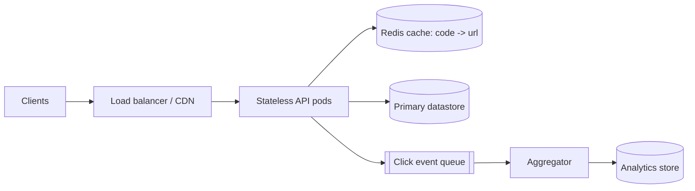

# 03 Design

## Architecture (target)

The prototype implements the API tier, the repository interface and synchronous analytics. The cache, queue and aggregator are design-only.

## Components (prototype)

| Module | Responsibility |
|---|---|
| domain | Validation rules, code generation, error types (pure functions) |
| repository | SQL persistence behind a small interface |
| service | Business logic: shorten, resolve, stats |
| app | WSGI HTTP layer and route table |
| openapi.json | API contract verified by tests |

## Data model

- `links(code PK, url, created_at)`
- `clicks(id PK, code, ts, referrer)` indexed on `(code, ts)`

## API

| Method | Path | Purpose | Responses |
|---|---|---|---|
| POST | `/api/v1/links` | Create a short link | 201, 400, 409 |
| GET | `/api/v1/links/{code}/stats` | Click analytics for a link | 200, 404 |
| GET | `/{code}` | Redirect to the original URL | 302, 404 |
| GET | `/healthz` | Liveness check | 200 |

## Capacity estimate (from assumptions)

| Item | Value |
|---|---|
| New links | 100,000,000 per month = 38.6/s |
| Redirects | 3,858/s average, 11,574/s at 3x peak |
| Link storage (5 years) | 6,000,000,000 records = 3.0 TB |
| Keyspace | 62^7 = 3,521,614,606,208; 0.17% used at retention, so collision retries stay rare |
| Raw click events | 333M/day = 12.2 TB/year: aggregate, do not keep raw forever |

## Key decisions and trade-offs

- **Short-code generation: Random base62, 7 chars, unique constraint + retry.** Counter+base62 is enumerable and needs coordination; hash-of-URL collides and cannot give two codes for one URL. Random codes need no coordination across nodes; the unique key makes collisions safe (retry).
- **Redirect status: HTTP 302.** 301 is cached by browsers, so repeat clicks would never reach the service and analytics would undercount.
- **Datastore: SQLite behind a repository interface (prototype); PostgreSQL/DynamoDB in production.** Zero-dependency and testable now; the interface isolates the swap. SQLite has one writer, so it caps write throughput.
- **Click analytics path: Synchronous insert (prototype); queue + aggregation in production.** Simple and correct now, but it adds a write to every redirect. At the assumed scale raw events dominate storage.
- **Caching: None in the prototype; CDN/Redis cache of code->url in production.** Reads outnumber writes 100:1 and popular links are hot, so caching is the main read-scaling lever.
- **Framework: Plain WSGI, standard library only.** Runs anywhere and tests run without installs. Production would serve it with gunicorn behind a load balancer.

## Scale-out path

1. Add a cache in front of the datastore (largest read win).
2. Move to PostgreSQL with read replicas; shard by hash of the code if writes outgrow one primary.
3. Make analytics asynchronous: queue, then batch aggregation into daily counters.
4. Add rate limiting, abuse checks (reputation lists) and API keys at the edge.
