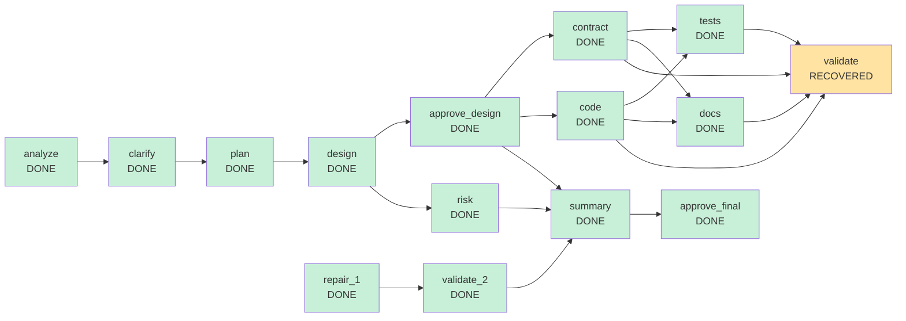

# Engineering summary

**Requirement:** Build a scalable URL shortener service with APIs, persistence, and analytics.
**Interpreted as:** greenfield change (url_shortener); ambiguity level medium.

## 1. What was built and why

Build a URL shortener service exposing a REST JSON API to create short links and redirect to the original URL (HTTP 302), persist links durably and record click analytics (total, per day, top referrers). Assumed targets: 100M new URLs/month, 100:1 read:write, p95 redirect < 100 ms, 99.9% availability.

Key design points:

- API tier is stateless; capacity at the assumed scale is about 38.6 writes/s and 3,858 reads/s.
- Random base62 codes with a unique constraint; HTTP 302 so every click is observable; repository interface for the datastore.
- Raw click events would reach about 12.2 TB/year, so production must aggregate them.

## 2. Assumptions the human approved

- A1 Scale: 100M new URLs/month, 100:1 read:write, p95 redirect < 100 ms, 99.9% availability, 5-year retention.
- A2 Datastore: SQLite behind a repository interface for the prototype; PostgreSQL or DynamoDB recommended in production.
- A3 Analytics scope: Total clicks, clicks per day and top referrer hosts. No IP address or user agent is stored.
- A4 Access control: No authentication in the prototype. API keys and rate limits are listed as production follow-up.
- A5 Link semantics: Every request creates a new random 7-char base62 code; optional custom alias; no expiry; redirects use 302 so every click is observable.

Human approvals recorded: clarify (approved: auto-approved (demo mode)), approve_design (approved: auto-approved (demo mode))

## 3. Implementation plan and rationale

| Task | Agent | Depends on | Why |
|---|---|---|---|
| design | design | plan | Design first: every later artifact derives from it. |
| approve_design | gate | design | Controlled autonomy: a human signs off before any code is generated. |
| contract | contract | approve_design | Contract-first: tests will later verify the code against this file. |
| code | code | approve_design | Independent of the contract, so it runs in parallel with it. |
| tests | tests | contract, code | Needs the contract (what to verify) and the code (what to import). |
| docs | docs | contract, code | Documentation must reflect the final contract and code. |
| risk | risk | design | Pure analysis of the design, so it runs in parallel with code generation. |
| validate | validate | code, tests, contract, docs | Quality gate. On failure the orchestrator spawns repair and re-validation. |
| summary | summary | validate, risk, approve_design | Assemble plan, artifacts, risks, trade-offs and limitations. |
| approve_final | gate | summary | A human reviews the evidence before the outcome is accepted. |

## 4. Generated artifacts

**Project**

- `project/README.md` (1,273 bytes)
- `project/docs/runbook.md` (486 bytes)
- `project/openapi.json` (5,309 bytes)
- `project/shortener/__init__.py` (97 bytes)
- `project/shortener/app.py` (4,533 bytes)
- `project/shortener/domain.py` (2,020 bytes)
- `project/shortener/repository.py` (2,650 bytes)
- `project/shortener/service.py` (1,855 bytes)
- `project/tests/__init__.py` (0 bytes)
- `project/tests/helpers.py` (1,011 bytes)
- `project/tests/test_contract.py` (3,028 bytes)
- `project/tests/test_integration.py` (3,171 bytes)
- `project/tests/test_unit.py` (4,376 bytes)

**Documentation**

- `docs/01_requirements.md` (2,419 bytes)
- `docs/02_plan.md` (1,678 bytes)
- `docs/03_design.md` (3,211 bytes)
- `docs/04_risks_and_validation.md` (3,404 bytes)

## 5. Validation results

- [PASS] static analysis: syntax, banned calls, SQL parameterisation, secrets: clean
- [PASS] OpenAPI contract is valid JSON with paths: 4 paths
- [PASS] README present: 
- [PASS] test suite (unit, integration, contract / regression): 24 tests in 6.04s

## 6. Risks, trade-offs and validation approach

| ID | Risk | Mitigation | Status |
|---|---|---|---|
| R1 | Abuse: shortener used to hide phishing or malware destinations | Scheme allow-list (done). Reputation checks, takedown workflow and per-client rate limits. | Partly mitigated |
| R2 | Dangerous URI schemes (javascript:, data:) used as redirect targets | Only absolute http/https URLs with a host are accepted; covered by a unit test. | Mitigated, tested |
| R3 | Short-code guessing or enumeration | Random 7-char base62 from a secure source (3.5T keyspace). Add rate limiting at the edge. | Mitigated |
| R4 | Code collision on creation | Unique constraint plus bounded retry; covered by a unit test with a forced collision. | Mitigated, tested |
| R5 | Hot links overload the datastore (100:1 read-heavy) | Cache in front of the datastore; CDN for the most popular links. | Design only |
| R6 | SQLite single writer and synchronous click insert cap throughput | Repository interface allows PostgreSQL; make analytics asynchronous via a queue. | Design only |
| R7 | Raw click data grows to terabytes per year | Aggregate into daily counters and expire raw events. | Design only |
| R8 | PII leaks through referrers or user agents | Only the referrer host is stored; no IP or user agent. | Mitigated |
| R9 | API contract drifts from the implementation | Contract test compares routes, status codes and required fields to openapi.json. | Mitigated, tested |
| R10 | Data loss | Backups and replication in production; not in the prototype. | Design only |

Validation strategy:

- **Unit tests:** Domain rules and service behaviour with an in-memory repository and a fake clock.
- **Integration tests:** Full HTTP flow through the WSGI app with a real SQLite file, including restart persistence.
- **Contract tests:** Routes, status codes and required response fields are checked against openapi.json.
- **Static checks:** Syntax, banned calls, string-built SQL and hard-coded secrets are scanned in generated code.
- **Repair loop:** On failure, failing tests are mapped to the faulty module, which is regenerated and re-validated (bounded).
- **Not covered:** Load, soak, chaos and multi-node behaviour; real payment-scale data; penetration testing.

Key trade-offs:

- **Short-code generation:** Random base62, 7 chars, unique constraint + retry. Counter+base62 is enumerable and needs coordination; hash-of-URL collides and cannot give two codes for one URL. Random codes need no coordination across nodes; the unique key makes collisions safe (retry).
- **Redirect status:** HTTP 302. 301 is cached by browsers, so repeat clicks would never reach the service and analytics would undercount.
- **Datastore:** SQLite behind a repository interface (prototype); PostgreSQL/DynamoDB in production. Zero-dependency and testable now; the interface isolates the swap. SQLite has one writer, so it caps write throughput.
- **Click analytics path:** Synchronous insert (prototype); queue + aggregation in production. Simple and correct now, but it adds a write to every redirect. At the assumed scale raw events dominate storage.
- **Caching:** None in the prototype; CDN/Redis cache of code->url in production. Reads outnumber writes 100:1 and popular links are hot, so caching is the main read-scaling lever.
- **Framework:** Plain WSGI, standard library only. Runs anywhere and tests run without installs. Production would serve it with gunicorn behind a load balancer.

## 7. Assumptions and limitations

- Offline mode generates code from reviewed templates. Requirement analysis, planning, impact analysis, validation and repair are real logic, but open-ended code generation needs a hosted LLM behind the same agent interface.
- Repair is rule-based: it fixes failures that map to a known module and escalates everything else to a human.
- Offline mode covers the URL shortener domain (greenfield) and two change types on the sample repo (collision fix, LRU cache). Other requirements stop with a clear message.
- The optional LLM adapter is advisory only and has been exercised against a local mock endpoint, not a production provider.
- Validation runs the generated tests in a subprocess; it does not include load, soak, chaos or security penetration testing.
- Thresholds and capacity figures come from stated assumptions, not measurements.
- A fault was deliberately injected in this run to demonstrate detection and repair (see the execution trace).

## 8. Execution trace

**Run status: completed**

| Task | Agent | Status | Attempts | Start (s) | Duration (s) | Result |
|---|---|---|---|---|---|---|
| analyze | analyze | DONE | 1 | 0.0 | 0.0 | greenfield / url_shortener; 5 ambiguities (0 blocking) |
| clarify | gate | DONE | 1 | 0.0 | 0.0 | approved: auto-approved (demo mode) |
| plan | plan | DONE | 1 | 0.0 | 0.0 | 10 tasks planned |
| design | design | DONE | 2 | 0.0 | 0.3 | greenfield design with capacity estimate |
| approve_design | gate | DONE | 1 | 0.4 | 0.0 | approved: auto-approved (demo mode) |
| contract | contract | DONE | 1 | 0.4 | 0.0 | OpenAPI 3.0.3 with 4 operations |
| code | code | DONE | 1 | 0.4 | 0.0 | 5 source files |
| tests | tests | DONE | 1 | 0.4 | 0.0 | 5 test files, 24 test methods (unit, integration, contract) |
| docs | docs | DONE | 1 | 0.4 | 0.0 | README and runbook |
| risk | risk | DONE | 1 | 0.4 | 0.0 | 10 risks, 5 failure scenarios, 6 validation layers |
| validate | validate | RECOVERED | 1 | 0.4 | 4.8 | test suite (unit, integration, contract / regression): 24 tests in 4.81s; failing: test_cr |
| summary | summary | DONE | 1 | 11.3 | 0.0 | engineering summary written |
| approve_final | gate | DONE | 1 | 11.3 | 0.0 | approved: auto-approved (demo mode) |
| repair_1 | repair | DONE | 1 | 5.2 | 0.0 | repaired D1 |
| validate_2 | validate | DONE | 1 | 5.2 | 6.1 | all 4 checks passed, 24 tests pass |

Maximum tasks running at the same time: 2 (contract, code).

Notable events (retries, faults, repairs, graph rewiring, gates):

-    0.0s  `clarify`  gate: APPROVED: auto-approved (demo mode)
-    0.0s  `plan`  spawn: design, approve_design, contract, code, tests, docs, risk, validate, summary, approve_final
-    0.1s  `design`  retry: simulated tool timeout while loading design knowledge (attempt 1/3)
-    0.3s  `approve_design`  gate: APPROVED: auto-approved (demo mode)
-    0.4s  `code`  fault: injected D1: redirect path forgets to record the click (analytics silently broken)
-    5.2s  `validate`  failed: test suite (unit, integration, contract / regression): 24 tests in 4.81s; failing: test_create_redirect_and_stats_flow, test_resolve_records_click, test_stats_aggregates_clicks_by_day_and_referrer -> spawning repair_1 and validate_2
-    5.2s  `validate`  rewire: downstream tasks now wait for validate_2
-    5.2s  `repair_1`  repaired: D1: regenerated shortener/service.py (redirect path forgets to record the click (analytics silently broken))
-   11.3s  `approve_final`  gate: APPROVED: auto-approved (demo mode)

Task graph:

